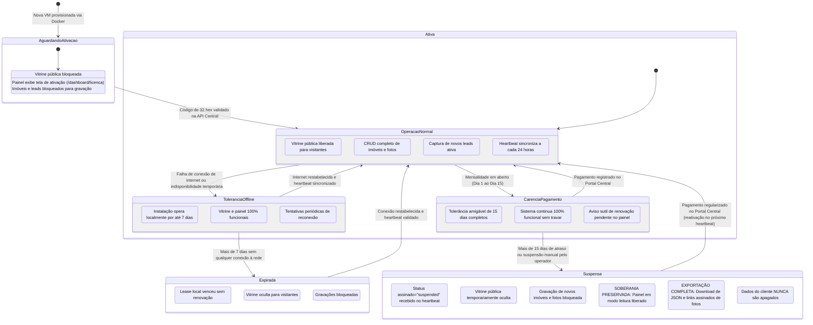

# Pepius Imob — contexto canônico

Esta é a nota de contexto do produto dentro do repositório. Antes de alterar o escopo, confira esta nota e [[PLANO_ON_PREMISE]]. Depois de cada entrega, atualize a nota, [[RESUMO]] e a documentação afetada. Para decisões arquiteturais difíceis de reverter, consulte [[adr/0001-on-prem-postgresql-and-license-control-plane]] e [[adr/0002-auth-helpers-in-public-schema]]. A futura plataforma Pepius pertence a outro produto; seu objetivo fica em [[PLANO_CONTROL_PLANE_FUTURO]].

## Objetivo

Entregar a cada imobiliária uma instalação isolada em VM, com uma vitrine pública para imóveis e um painel gerencial autenticado para a própria equipe. A Pepius licencia o aplicativo por serviço central e publica versões. Imóveis, dados de contato e leads ficam na infraestrutura operada pelo cliente.

### Dentro do produto da imobiliária

- Vitrine responsiva: busca, lista, detalhe de imóveis e formulário de contato.
- Painel gerencial: imóveis, fotos, leads e personalização básica da vitrine.
- Uma instalação por imobiliária, com autenticação por usuário e tenant local.
- Supabase self-hosted em Docker Compose; banco PostgreSQL local.
- Licença assinada e validada localmente, heartbeat diário, tolerância de sete dias offline e exportação local.

### Fora deste produto

- Painel global do dono da Pepius, cadastro comercial de clientes, gestão de pagamentos e finanças.
- Gateway de pagamento, cobranças automatizadas e emissão fiscal.
- Inbox omnichannel, WhatsApp, calendário e IA.
- MySQL, SaaS multi-imobiliária ou dados de imóveis/leads enviados ao controle central.

## Arquitetura de instalação

### Diagrama Geral da Estrutura do Sistema

```mermaid
flowchart TB
    subgraph CLIENT_PREMISE["🏢 AMBIENTE DO CLIENTE (Instalação On-Premise na VM da Imobiliária)"]
        direction TB
        
        subgraph USERS["Usuários e Acessos"]
            PUBLIC_USER["👤 Visitantes e Clientes<br/>(Compradores e Locatários)"]
            AGENCY_TEAM["👔 Equipe da Imobiliária<br/>(Corretores e Gestores)"]
        end

        subgraph EDGE["Borda e Proxy"]
            CADDY["🛡️ Caddy Server (Proxy Reverso)<br/>Terminação TLS Automática / Porta 443"]
        end

        subgraph APP["Aplicação Pepius Imob (Next.js 16 App Router)"]
            direction TB
            VITRINE["🌐 Vitrine Pública<br/>• Catálogo e Busca de Imóveis<br/>• Detalhes e Galeria de Fotos<br/>• Form de Leads (Honeypot + Rate Limit)"]
            DASHBOARD["📊 Painel Gerencial Autenticado<br/>• Gestão Completa de Imóveis<br/>• CRM de Leads e Atendimento<br/>• Personalização Visual da Vitrine<br/>• Tela de Licença e Ativação"]
            LICENSE_CLIENT["🔑 Módulo Local de Licença<br/>• Chaves Ed25519 da Instalação<br/>• Verificador Criptográfico Local<br/>• Agente de Heartbeat Diário"]
        end

        subgraph LOCAL_DATA["Dados e Armazenamento (Supabase Self-Hosted Local)"]
            direction TB
            PG_LOCAL[("🐘 PostgreSQL Local<br/>• Imóveis, Preços e Fotos<br/>• Leads e Histórico de Contatos<br/>• Perfis e Tenant da Imobiliária<br/>• Tabela local_license_state")]
            STORAGE_LOCAL["📁 Supabase Storage Local<br/>Fotos de Imóveis (URLs Privadas Assinadas)"]
            AUTH_LOCAL["🔐 Supabase Auth (GoTrue)<br/>Sessões JWT Seguras e RLS por Tenant"]
        end
    end

    subgraph PEPIUS_CLOUD["☁️ CONTROLE CENTRAL PEPIUS (Control Plane Independente)"]
        direction TB
        PEPIUS_ADMIN["👨‍💼 Equipe Pepius (Operador / Vendas)"]
        PORTAL_LICENCA["💻 Portal de Licenças Pepius<br/>(pepius-license-portal.vercel.app)"]
        API_LICENCA["⚡ API Central de Licenciamento<br/>(/api/licensing/v1/activate & heartbeat)"]
        DB_CENTRAL[("🔒 DB Central de Licenças<br/>• Chave Privada Ed25519 Central<br/>• Contas, Pagamentos e MRR<br/>• Hash de Códigos de Ativação")]
    end

    %% Conexões de Entrada
    PUBLIC_USER -->|"Acesso Web HTTPS"| CADDY
    AGENCY_TEAM -->|"Acesso Gerencial HTTPS"| CADDY
    CADDY -->|"Encaminhamento Interno"| APP

    %% Módulos da Aplicação
    APP --> VITRINE
    APP --> DASHBOARD
    APP --> LICENSE_CLIENT

    %% Operações Locais
    VITRINE -->|"Leitura Pública Sanitizada / Gravação de Leads"| PG_LOCAL
    DASHBOARD -->|"CRUD Completo / Isolamento RLS"| PG_LOCAL
    DASHBOARD -->|"Upload e Exclusão Segura"| STORAGE_LOCAL
    APP -->|"Validação de Sessão"| AUTH_LOCAL
    LICENSE_CLIENT <-->|"Leitura e Gravação de Lease Local"| PG_LOCAL

    %% Operações Centrais
    PEPIUS_ADMIN -->|"Emite e Gerencia Licenças"| PORTAL_LICENCA
    PORTAL_LICENCA -->|"Registra Pagamentos e Emite Código"| DB_CENTRAL
    PORTAL_LICENCA --> API_LICENCA

    %% Fluxo de Licenciamento On-Premise <-> Central
    AGENCY_TEAM -.->|"1. Insere Código de Ativação no Painel"| DASHBOARD
    LICENSE_CLIENT ==>|"2. Ativação & Heartbeat Diário (Assinado Ed25519)"| API_LICENCA
    API_LICENCA -->|"Valida Código / Status Financeiro"| DB_CENTRAL
    API_LICENCA ==>|"3. Retorna Lease Assinada (7 dias de validade)"| LICENSE_CLIENT

Durante desenvolvimento, usamos Supabase Cloud. Para cliente, usamos a stack oficial Supabase self-hosted em Docker Compose e PostgreSQL. `SUPABASE_INTERNAL_URL` atende chamadas server-side na rede Docker; `NEXT_PUBLIC_SUPABASE_URL` é a URL HTTPS pública de Kong. Caddy termina TLS e sobrescreve `X-Real-IP`. PostgreSQL/Studio não são publicados na Internet. Helpers de RLS ficam em `public` com `SECURITY DEFINER`, `search_path` vazio e lookup pelo usuário autenticado; migrations não alteram o schema protegido `auth`.
O Vercel Production está sendo usado temporariamente para avaliar o produto; não substitui uma instalação de cliente on-premise. `LICENSE_DEV_BYPASS=true` só funciona em `VERCEL_ENV=preview` ou no desenvolvimento local; Production exige uma lease assinada ativa. Preview deve usar credenciais e dados Supabase de desenvolvimento isolados.
Para abrir a vitrine de Preview sem consultar uma licença, configure `LICENSE_DEV_BYPASS=true` no escopo Preview do Vercel. Sem variáveis Supabase e tenant, a aplicação abre com catálogo vazio e autenticação desabilitada; o login volta a funcionar quando o Supabase é configurado. Para trabalhar com dados, configure no Preview `NEXT_PUBLIC_SUPABASE_URL`, `NEXT_PUBLIC_SUPABASE_ANON_KEY`, `SUPABASE_SERVICE_ROLE_KEY` (server-only), `PEPIUS_TENANT_ID` e `LEAD_RATE_LIMIT_PEPPER`, todos ligados a um projeto de desenvolvimento isolado. Nunca copie credenciais de produção ou de clientes.

## Interface da vitrine e painel gerencial

A rota inicial preserva a composição aprovada da marca Linha de Planta: navegação limpa, hero serifado, busca, destaques e rodapé institucional. O hero usa título/subtítulo configurados no tenant; a seção de destaques só aparece quando há imóveis marcados. O conteúdo público é estritamente voltado a compradores e locatários; o botão de login administrativo foi removido do topo público e substituído por um hiperlink institucional discreto `"Imobiliária"` no rodapé (direcionando a `/login`). A busca da home envia texto e finalidade para a listagem. Imóveis com finalidade "ambos" exibem preço de venda e de locação juntos na home, na listagem e no detalhe. O tema padrão é **claro** (`light`), com suporte completo a tema escuro via `@custom-variant dark` do Tailwind v4; o seletor `ThemeToggle` está presente tanto no cabeçalho público quanto no painel gerencial. A vitrine cumpre a LGPD apresentando o banner de consentimento de cookies (`CookieConsentBanner`) com persistência em `localStorage` e a página de Política de Privacidade (`/privacidade`).

Ambas as interfaces (vitrine e painel administrativo) são 100% responsivas para dispositivos móveis (320px–428px):
- Viewport explícito em `src/app/layout.tsx` (`export const viewport: Viewport`) garantindo proporção e escala 1:1 sem zoom-out do navegador.
- Tabelas de imóveis e leads com adaptação fluida: em telas mobile (`md:hidden`), os registros são renderizados em cards verticais ergonômicos com botões de ação e atalhos rápidos (`tel:` / `mailto:` para contatos), mantendo a visualização tabular clássica em desktop (`hidden md:block`).
- Menu mobile do painel gerencial com touch targets mínimos de 44px e ícones semânticos para todas as rotas (incluindo licença).
- Componentes flutuantes (FAB de contato e banner de cookies) posicionados com margens seguras e largura responsiva sem sobreposição ou quebra de tela.

## Segurança e dados

- O navegador recebe apenas a anon key do Supabase. Service-role, pepper, tokens de operadores e chave privada são server-side; a chave privada só existe na Pepius.
- O público não tem leitura direta das tabelas privadas. O servidor consulta imóveis com projeção explícita e retorna bairro/cidade, sem endereço completo ou CEP.
- Consultas usam PostgREST parametrizado. Zod valida corpos estritos, UUIDs, limites de texto/preço/imagens; uploads verificam assinatura do conteúdo e tenant proprietário e são re-encodados com `sharp` (remove EXIF/GPS, limita o lado maior a 2400 px).
- RLS limita registros à imobiliária; Storage privado guarda fotos por caminho de tenant e entrega URLs assinadas com expiração de cinco minutos (até uma hora para exportação). Excluir um imóvel remove também os objetos correspondentes do Storage.
- Leads públicos passam por honeypot e limite atômico por IP, cujo hash usa pepper local. O endpoint valida imóvel e licença antes de gravar; nenhum lead vai ao controle central.
- Autorização é revalidada no servidor e na política RLS; o proxy Next 16 é apenas uma ajuda de navegação. Campos devolvidos por APIs públicas são whitelisted.
- Operações comerciais são auditadas centralmente. Limites e resposta a incidentes estão em [[SEGURANCA]].

## Licenciamento

Uma instalação gera um par de chaves Ed25519 local. O operador emite um código de uso único e o cliente ativa localmente. A API central guarda hash do código e chave pública da instalação; entrega lease assinado com status, funcionalidades, validade e instalação. O banco local guarda o lease e a chave pública Pepius usada para validar a assinatura. A chave privada de assinatura não é distribuída.

Heartbeat é assinado pela chave da instalação e ocorre a cada 24h. O lease dura no máximo sete dias, o que permite operar offline por até sete dias. Pagamento vencido não suspende antes de 15 dias completos; a partir daí o central retorna lease suspenso, aplicado no próximo heartbeat. Se a rede ficar indisponível, o lease expirado bloqueia a vitrine e escritas. Em suspensão, painel em leitura e exportação continuam; os dados não são removidos. Pagamento registrado restaura na resposta do heartbeat seguinte. Suspensão manual pode ser imediata.

No modo suspenso, o app oculta a vitrine, bloqueia gravações no servidor e no RLS, mantém leitura do tenant no painel e oferece JSON com imóveis/leads e links assinados para fotos. Esses links expiram em até uma hora.

O licenciamento é uma regra de operação oficial e não proteção inviolável contra quem controla a VM/root. A licença não é kill switch remoto instantâneo: depende do próximo heartbeat ou do fim da validade local.

### Diagrama de Sequência: Ativação e Heartbeat Diário

```mermaid
sequenceDiagram
    autonumber
    actor Operador as 👨‍💼 Operador Pepius
    participant Portal as 💻 Portal de Licenças Central
    actor Imobiliaria as 🏢 Responsável Imobiliária
    participant WebApp as ⚡ Next.js (Painel Local)
    participant DBLocal as 🐘 PostgreSQL Local (VM)
    participant APICentral as ☁️ API Central de Licenciamento
    participant DBCentral as 🔒 DB Central de Licenças

    Note over Operador, DBCentral: FASE 1: EMISSÃO DO CÓDIGO DE ATIVAÇÃO
    Operador->>Portal: Cadastra conta da imobiliária e plano contratado
    Portal->>DBCentral: Gera código de ativação criptográfico (32 hex) com hash SHA-256
    DBCentral-->>Portal: Código emitido (válido por 7 dias para resgate)
    Operador->>Imobiliaria: Envia código de ativação (ex: WhatsApp / E-mail / Onboarding)

    Note over Imobiliaria, DBLocal: FASE 2: ATIVAÇÃO VIA PAINEL DA IMOBILIÁRIA (/dashboard/licenca)
    Imobiliaria->>WebApp: Acessa /dashboard/licenca e cola o código de ativação
    WebApp->>DBLocal: Verifica se par de chaves Ed25519 local existe (gera se necessário)
    DBLocal-->>WebApp: Chave pública local da instalação obtida
    WebApp->>APICentral: POST /api/licensing/v1/activate (code, installation_id, public_key)
    APICentral->>DBCentral: Valida hash do código, status financeiro e vincula chave pública
    DBCentral-->>APICentral: Licença vinculada à instalação com sucesso
    APICentral->>APICentral: Monta Lease (status="active", features, expira em 7 dias)<br/>e assina digitalmente com a Chave Privada Central (Ed25519)
    APICentral-->>WebApp: Retorna Lease Assinado + Chave Pública Central Pepius
    WebApp->>WebApp: Valida assinatura criptográfica Ed25519 do lease recebido
    WebApp->>DBLocal: Salva lease assinado na tabela local_license_state
    WebApp-->>Imobiliaria: Exibe badge "Licença Ativa", data de renovação e recursos liberados

    Note over WebApp, DBCentral: FASE 3: CICLO DE HEARTBEAT CONTÍNUO (A CADA 24 HORAS)
    loop A cada 24 Horas (Cron / Background Sync)
        WebApp->>DBLocal: Lê lease local e par de chaves da instalação
        WebApp->>WebApp: Gera payload de heartbeat assinado com chave privada local
        WebApp->>APICentral: POST /api/licensing/v1/heartbeat (lease_id, signature, timestamp)
        APICentral->>DBCentral: Consulta situação financeira e status da conta
        alt Pagamento em dia ou carência < 15 dias
            APICentral->>APICentral: Emite novo Lease assinado renovando validade por +7 dias
            APICentral-->>WebApp: 200 OK + Novo Lease Assinado
            WebApp->>DBLocal: Atualiza local_license_state com novo vencimento
        else Inadimplência > 15 dias ou suspensão manual
            APICentral->>APICentral: Emite Lease assinado com status="suspended"
            APICentral-->>WebApp: 200 OK + Lease Suspenso Assinado
            WebApp->>DBLocal: Grava status="suspended" (ativa Modo Leitura/Exportação)
        end
    end
```

### Diagrama de Estados: Ciclo de Vida da Instalação e Licença



### Como Explicar a Estrutura e Licenciamento para Qualquer Pessoa (Pitch de 2 Minutos)

Seja para clientes imobiliários, parceiros técnicos, investidores ou operadores de suporte, a arquitetura do **Pepius Imob** pode ser explicada através de 4 pilares fundamentais:

1. **Soberania Absoluta de Dados (On-Premise vs SaaS Convencional):**
   - *O Problema do SaaS:* No modelo SaaS tradicional, os dados de centenas de imobiliárias ficam misturados no mesmo banco de dados na nuvem da empresa fornecedora. Se a empresa vazar dados ou sofrer bloqueio judicial, todos são afetados.
   - *A Solução Pepius:* O Pepius Imob roda em uma Máquina Virtual (VM) isolada e dedicada exclusivamente àquela imobiliária. O banco de dados PostgreSQL, os leads de compradores e as fotos em alta resolução ficam fisicamente sob custódia da própria imobiliária. A Pepius **não tem acesso** aos imóveis nem aos contatos de clientes.

2. **Licenciamento Criptográfico Assinado (Sem Espionagem):**
   - Para garantir o modelo comercial de licenciamento de software sem precisar ler os dados do cliente, utilizamos **criptografia assimétrica Ed25519** (o mesmo padrão de alta segurança usado em carteiras digitais e SSH).
   - A API Central de Licenças apenas emite uma credencial digital matemática (*Lease*) atestando que a instalação tem permissão de operar. A instalação valida essa assinatura localmente de forma offline, sem enviar dados de imóveis, leads ou faturamento para a central.

3. **Resiliência e Tolerância a Falhas de Internet (Até 7 Dias Offline):**
   - A cada 24 horas, o sistema realiza um *heartbeat* silencioso para renovar a autorização.
   - Cada autorização concedida tem validade estendida de **7 dias**. Caso o link de internet da imobiliária sofra instabilidade ou a API passe por manutenção, a vitrine e o painel continuam funcionando normalmente por até uma semana ininterrupta.

4. **Segurança Jurídica, Carência e Preservação de Dados:**
   - *Carência amigável de 15 dias:* Se houver atraso bancário ou troca de cartão, o sistema não é interrompido sumariamente; a imobiliária possui 15 dias de carência operacional total.
   - *Não destrutividade:* Caso a licença seja suspensa após a carência, os dados da imobiliária **jamais são apagados**. O sistema bloqueia a vitrine pública e novas gravações, mas mantém o painel liberado em **modo somente leitura e exportação**, permitindo à imobiliária baixar um arquivo JSON estruturado com todos os seus imóveis, leads e links de download de fotos a qualquer tempo.

## Operação e responsabilidades

- **Cliente:** VM, domínio/DNS, credenciais locais, PostgreSQL, armazenamento de imagens, firewall, criptografia, backups, teste de restauração e acesso root.
- **Pepius:** serviço de licença, material privado de assinatura, tokens de operador, releases, migrations, documentação e correções do aplicativo.
- **Desenvolvimento:** Supabase Cloud de desenvolvimento. Nunca use credenciais de clientes nos ambientes de desenvolvimento.
- **Instalação:** Supabase Compose isolado + Compose Pepius; update com release/imagem versionada e migration revisada.

## Estado implementado e pontos de validação

- Vitrine usa dados do banco local; busca/lista/detalhe não usam mais mocks.
- Lead público é gravado e associado ao imóvel no tenant configurado.
- Painel de leads permite buscar, filtrar por status, abrir detalhe e alterar status; painel de imóveis oferece busca, filtros reais de tipo/status e indicador de destaque.
- Venda e locação simultâneas são exibidas com preços separados; destaque é uma coluna `featured` configurável no painel.
- APIs gerenciais incluem CRUD de imóvel, imagens, status de lead, configurações whitelisted e exportação.
- As configurações de título, descrição e cores validadas são aplicadas na home, na lista e nos detalhes públicos; a identidade da imobiliária vem do tenant local.
- Falhas de upload/capa/exclusão de foto são exibidas ao usuário; uploads passam por re-encode que remove metadados e o delete do imóvel limpa o Storage.
- Navegação mobile e desktop do painel humanizada com `dashboard-nav-links` ("Visão Geral", "Catálogo de Imóveis", "Contatos de Clientes", "Personalização do Site", atalho "Site ↗" e rota ativa via `usePathname`); login não referencia rota inexistente; vitrine possui banner de cookies e política de privacidade completa de acordo com a LGPD.
- Controle de licença inclui geração/administração CLI, código de ativação, assinatura, heartbeat e estado local. O painel da imobiliária possui tela dedicada (`/dashboard/licenca`) que exibe status, tempo restante com barra de progresso, data de expiração, funcionalidades e ID da instalação, permitindo ao responsável ativar ou renovar a licença colando o código gerado pelo Portal de Licenças diretamente na interface web via `POST /api/dashboard/licensing/activate` ou forçar novo heartbeat via `POST /api/dashboard/licensing/sync`.
- Admin global e Inbox foram removidos da instalação da imobiliária; API central de licença fica desabilitada nela.
- Dockerfiles/Compose de app e agente, Caddy e migrations separados foram adicionados; `DEPLOY.md` aponta para o fluxo on-premise e trata Vercel apenas como preview.
- Testes locais cobrem assinatura, adulteração/validade, limite de atraso, heartbeat, preços por oferta e validação de imóvel; validar RLS/SQL, provisionamento, instalação e restore em instância Supabase self-hosted antes de liberar cliente.
- **Portal Administrativo de Licenças (`pepius-license-portal`):** Criado em repositório GitHub e diretório local dedicado (`https://github.com/matheushentges/pepius-license-portal` / `c:\Users\Matheus\Documents\pepius-license-portal`) e implantado em projeto Vercel próprio (`https://pepius-license-portal.vercel.app`), totalmente desacoplado do repositório da imobiliária. Conectado ao Supabase do Control Plane (`lwsnunuufkqmursocztg`). O portal roda em Next.js 16 independente com autenticação de operadores via Supabase Auth (SSR), proteção server-only, design system Linha de Planta e suporte completo a: Dashboard de métricas financeiras/MRR, listagem com busca/filtros, emissão de nova licença com código de ativação de 7 dias e comando CLI, registro de pagamentos, suspensão/reativação manual e trilha imutável de auditoria.

## Verificação desta entrega

- `npm run type-check`, `npm run lint`, `npm test` (9 testes) e `npm run build` passaram em 22/10. O lint mantém cinco avisos de `` em previews/URLs assinadas.
- A migration `20261022000001_property_featured.sql` foi validada com `npx supabase db push --dry-run`, aplicada ao Supabase Cloud de avaliação em 22/10 após backup/export das tabelas e verificada por consulta à coluna `featured`.
- `docker compose config` passou com o arquivo de exemplo. O daemon Docker não está disponível para validar Supabase self-hosted, RLS/pgTAP ou restore em VM. As migrations anteriores foram aplicadas com sucesso ao Supabase Cloud usado temporariamente para avaliação.
- `npm audit --omit=dev` não encontrou vulnerabilidades de runtime. O audit completo sinaliza cinco ocorrências high do advisory de `braces` no encadeamento de lint; atualizar forçando rebaixaria Next e não foi aplicado.

## Ambiente temporário de avaliação (21/10/2026)

Após autorização do proprietário, o Supabase Cloud atualmente associado ao Vercel Production está sendo usado temporariamente para avaliar a vitrine. Foi criado o tenant Linha de Planta, slug linha-de-planta-demonstracao, UUID 64377038-0f9c-40fa-bdac-cd928924f624. Ele contém 10 anúncios fictícios disponíveis em 10 cidades, distribuídos entre venda (4), locação (4) e ambas as finalidades (2). As descrições identificam os anúncios como demonstrativos. Não foram adicionadas imagens, então a vitrine usa o placeholder.

As variáveis de Production no Vercel foram atualizadas com URL, chaves Supabase, tenant e pepper. O Supabase CLI 2.121.0 foi autenticado e as dez migrations então existentes foram aplicadas; site_config existe, Storage de imagens está privado e RLS restringe acesso. A migration de destaque `20261022000001_property_featured.sql` foi criada depois, passou em `db push --dry-run` e foi aplicada em 22/10 após backup/export das tabelas. Os 10 imóveis demonstrativos permanecem. O perfil global existente foi vinculado a esse tenant como imobiliaria_owner. O control plane temporário Pepius License Control usa o projeto Supabase `lwsnunuufkqmursocztg` (organização Free, região sa-east-1); a migration própria foi aplicada e as variáveis de assinatura/operação foram configuradas no ambiente local e em Vercel Production. As chaves legadas desse projeto foram desativadas após aparecerem no retorno do CLI; o serviço usa a chave `sb_secret` nova. O projeto Free pode pausar após período sem atividade e respeita o limite de dois projetos ativos gratuitos. Ainda falta publicar o deployment com essas variáveis e emitir/ativar a lease de avaliação; até isso ocorrer, Production continua fechada. Não apresentar os anúncios como inventário real; são dados temporários para avaliação.

## Manutenção do cérebro

Toda entrega de código deve atualizar esta nota e [[RESUMO]] com o comportamento real. Atualize plano, segurança, checklist e progresso quando forem afetados. Registre decisões de banco, protocolo, segurança, compatibilidade ou licenciamento em ADR. Mantenha documentos em UTF-8. Não reintroduza decisões antigas de SaaS, Inbox, IA ou MySQL sem rever o escopo com o usuário.

## Links do repositório

- [[PLANO_ON_PREMISE]] — escopo e implementação.
- [[REVISAO_MODULO_INICIAL]] — lacunas funcionais, segurança e operação identificadas para o MVP.
- [[SEGURANCA]] — controles, ameaças e responsabilidade operacional.
- [[GLOSSARY]] — termos do domínio.
- [[PLANO_CONTROL_PLANE_FUTURO]] — objetivo futuro da plataforma administrativa Pepius.
- [[RESUMO]] — estado atual do código e verificações.
- [[adr/0001-on-prem-postgresql-and-license-control-plane]] — decisão arquitetural aprovada.
- [[adr/0002-auth-helpers-in-public-schema]] — compatibilidade e segurança dos helpers de RLS.
