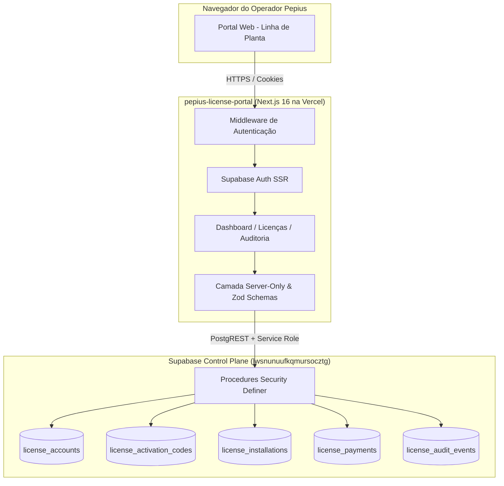

# Pepius License Portal Implementation Plan

> **For agentic workers:** REQUIRED SUB-SKILL: Use superpowers:subagent-driven-development to implement this plan task-by-task. Steps use checkbox (`- [ ]`) syntax for tracking.

**Goal:** Construir o Portal Administrativo Oficial da Pepius (`pepius-license-portal`) em Next.js 16 independente, conectado ao Supabase do Control Plane (`lwsnunuufkqmursocztg`) e deployado na Vercel para gerenciar o ciclo de vida completo de licenças on-premise (emissão, ativação, pagamentos, suspensão, monitoramento de heartbeats e auditoria).

**Architecture:** O portal é uma aplicação Next.js 16 (App Router) isolada do produto da imobiliária, garantindo separação absoluta de privilégios. Operadores autenticam via Supabase Auth (SSR com cookies HTTP-only). Todas as mutações e consultas administrativas utilizam clientes `server-only` com `service_role` invocando as procedures atômicas seguras do Postgres (`issue_license_account`, `record_license_payment`, `set_license_suspension`). A interface adota o Design System "Linha de Planta" com Tailwind CSS v4, suporte a tema escuro/claro e densidade de dados alta para produtividade.

**Architecture Diagram:**

**Tech Stack:**
- Next.js 16.3.x (App Router, React 19)
- TypeScript 5
- Tailwind CSS v4
- `@supabase/ssr` e `@supabase/supabase-js`
- Zod v3/v4
- `lucide-react`
- `next-themes`
- Node.js test runner nativo (`node --test`)

**Spec:** `docs/superpowers/specs/2026-10-22-license-control-portal-design.md`

## Global Constraints
- Diretório do projeto: `c:\Users\Matheus\Documents\pepius-license-portal`
- Nenhuma dependência com o repositório `pepius-imob` em runtime; zero risco de contaminação de chaves do control plane no bundle on-premise da imobiliária.
- Nenhuma exposição da chave `SUPABASE_SERVICE_ROLE_KEY` no client-side (`import 'server-only'` obrigatório).
- Tipografia: `DM Serif Display` para títulos/KPIs e `DM Sans` para texto/tabelas tabulares.
- Cores: Slate 700 (`#334155`), Terracota (`#E07A5F`), off-white (`#FAFAFA`) e slate dark (`#0F172A`).
- TypeScript estrito (`type-check` com 0 erros) e ESLint sem warnings de erro.

---

### Task 1: Scaffolding do Projeto e Configuração do Design System

**Files:**
- Create: `c:\Users\Matheus\Documents\pepius-license-portal/package.json`
- Create: `c:\Users\Matheus\Documents\pepius-license-portal/tsconfig.json`
- Create: `c:\Users\Matheus\Documents\pepius-license-portal/next.config.ts`
- Create: `c:\Users\Matheus\Documents\pepius-license-portal/postcss.config.mjs`
- Create: `c:\Users\Matheus\Documents\pepius-license-portal/eslint.config.mjs`
- Create: `c:\Users\Matheus\Documents\pepius-license-portal/src/app/globals.css`
- Create: `c:\Users\Matheus\Documents\pepius-license-portal/src/app/layout.tsx`
- Create: `c:\Users\Matheus\Documents\pepius-license-portal/.gitignore`
- Create: `c:\Users\Matheus\Documents\pepius-license-portal/.env.example`

**Interfaces:**
- Produces: Ambiente Next.js 16 funcional com Tailwind v4, tokens de CSS (`surface-*`, `text-*`, `border-*`), fontes Google `DM Serif Display` e `DM Sans`, e script de build/test/lint.

- [ ] **Step 1: Criar diretório e inicializar package.json**
- [ ] **Step 2: Configurar TypeScript e Next.js**
- [ ] **Step 3: Configurar Design System Linha de Planta em globals.css**
- [ ] **Step 4: Executar npm install e verificar build inicial**

---

### Task 2: Camada de Dados, Domínio e Supabase SSR

**Files:**
- Create: `c:\Users\Matheus\Documents\pepius-license-portal/src/lib/supabase/client.ts`
- Create: `c:\Users\Matheus\Documents\pepius-license-portal/src/lib/supabase/server.ts`
- Create: `c:\Users\Matheus\Documents\pepius-license-portal/src/lib/supabase/service-role.ts`
- Create: `c:\Users\Matheus\Documents\pepius-license-portal/src/lib/licensing/domain.ts`
- Create: `c:\Users\Matheus\Documents\pepius-license-portal/src/lib/licensing/types.ts`
- Create: `c:\Users\Matheus\Documents\pepius-license-portal/src/lib/security/schemas.ts`

**Interfaces:**
- Produces: Clientes Supabase SSR, domínio de licenças e validação Zod strict.

- [ ] **Step 1: Implementar tipos de domínio e utilitários de licença**
- [ ] **Step 2: Implementar esquemas Zod estritos**
- [ ] **Step 3: Implementar clientes Supabase SSR**

---

### Task 3: Testes Unitários de Domínio e Validação

**Files:**
- Create: `c:\Users\Matheus\Documents\pepius-license-portal/tests/domain.test.mjs`
- Create: `c:\Users\Matheus\Documents\pepius-license-portal/tests/schemas.test.mjs`

- [ ] **Step 1: Escrever testes unitários de status de licença**
- [ ] **Step 2: Escrever testes unitários de esquemas Zod**
- [ ] **Step 3: Executar npm test e verificar aprovação**

---

### Task 4: Autenticação de Operadores e Proteção de Rotas

**Files:**
- Create: `c:\Users\Matheus\Documents\pepius-license-portal/src/middleware.ts`
- Create: `c:\Users\Matheus\Documents\pepius-license-portal/src/app/(auth)/login/page.tsx`
- Create: `c:\Users\Matheus\Documents\pepius-license-portal/src/app/(auth)/layout.tsx`
- Create: `c:\Users\Matheus\Documents\pepius-license-portal/src/app/auth/actions.ts`

- [ ] **Step 1: Implementar Middleware de autenticação**
- [ ] **Step 2: Criar tela de login com Design System Linha de Planta**
- [ ] **Step 3: Implementar Server Action de Login e Logout**

---

### Task 5: Componentes UI Base e Layout Principal

**Files:**
- Create: `c:\Users\Matheus\Documents\pepius-license-portal/src/components/ui/button.tsx`
- Create: `c:\Users\Matheus\Documents\pepius-license-portal/src/components/ui/card.tsx`
- Create: `c:\Users\Matheus\Documents\pepius-license-portal/src/components/ui/input.tsx`
- Create: `c:\Users\Matheus\Documents\pepius-license-portal/src/components/ui/table.tsx`
- Create: `c:\Users\Matheus\Documents\pepius-license-portal/src/components/ui/badge.tsx`
- Create: `c:\Users\Matheus\Documents\pepius-license-portal/src/components/ui/modal.tsx`
- Create: `c:\Users\Matheus\Documents\pepius-license-portal/src/components/portal/sidebar.tsx`
- Create: `c:\Users\Matheus\Documents\pepius-license-portal/src/components/portal/header.tsx`
- Create: `c:\Users\Matheus\Documents\pepius-license-portal/src/components/portal/theme-toggle.tsx`
- Create: `c:\Users\Matheus\Documents\pepius-license-portal/src/app/(portal)/layout.tsx`

- [ ] **Step 1: Criar componentes base UI**
- [ ] **Step 2: Criar Sidebar e Header do Portal**
- [ ] **Step 3: Montar layout unificado do Portal**

---

### Task 6: Dashboard de Visão Geral

**Files:**
- Create: `c:\Users\Matheus\Documents\pepius-license-portal/src/app/(portal)/page.tsx`
- Create: `c:\Users\Matheus\Documents\pepius-license-portal/src/components/portal/metric-card.tsx`
- Create: `c:\Users\Matheus\Documents\pepius-license-portal/src/components/portal/recent-activity-table.tsx`

- [ ] **Step 1: Implementar busca server-side de métricas**
- [ ] **Step 2: Construir visual dos Cards de Métricas**
- [ ] **Step 3: Construir tabela de atividades recentes**

---

### Task 7: Módulo de Licenças — Listagem e Emissão

**Files:**
- Create: `c:\Users\Matheus\Documents\pepius-license-portal/src/app/(portal)/licencas/page.tsx`
- Create: `c:\Users\Matheus\Documents\pepius-license-portal/src/app/(portal)/licencas/nova/page.tsx`
- Create: `c:\Users\Matheus\Documents\pepius-license-portal/src/app/(portal)/licencas/actions.ts`
- Create: `c:\Users\Matheus\Documents\pepius-license-portal/src/components/portal/activation-code-dialog.tsx`

- [ ] **Step 1: Implementar listagem com filtros e busca**
- [ ] **Step 2: Implementar formulário de emissão**
- [ ] **Step 3: Implementar Server Action de emissão**
- [ ] **Step 4: Construir diálogo de entrega da licença com código e comando CLI**

---

### Task 8: Módulo de Licenças — Detalhes, Pagamentos e Suspensão

**Files:**
- Create: `c:\Users\Matheus\Documents\pepius-license-portal/src/app/(portal)/licencas/[id]/page.tsx`
- Create: `c:\Users\Matheus\Documents\pepius-license-portal/src/components/portal/payment-dialog.tsx`
- Create: `c:\Users\Matheus\Documents\pepius-license-portal/src/components/portal/suspend-dialog.tsx`
- Modify: `c:\Users\Matheus\Documents\pepius-license-portal/src/app/(portal)/licencas/actions.ts`

- [ ] **Step 1: Implementar página de detalhes**
- [ ] **Step 2: Construir Card de Instalação e Heartbeat**
- [ ] **Step 3: Implementar Modal de Registro de Pagamento**
- [ ] **Step 4: Implementar Ação de Suspensão / Reativação**

---

### Task 9: Módulo de Trilha de Auditoria

**Files:**
- Create: `c:\Users\Matheus\Documents\pepius-license-portal/src/app/(portal)/auditoria/page.tsx`
- Create: `c:\Users\Matheus\Documents\pepius-license-portal/src/components/portal/audit-table.tsx`

- [ ] **Step 1: Implementar consulta paginada de auditoria**
- [ ] **Step 2: Construir tabela de auditoria com expansão de detalhes**

---

### Task 10: Criação do Usuário Operador, Validação e Deploy Vercel

**Files:**
- Create: `c:\Users\Matheus\Documents\pepius-license-portal/scripts/create-operator.mjs`
- Create: `c:\Users\Matheus\Documents\pepius-license-portal/vercel.json`

- [ ] **Step 1: Criar script de provisionamento de operador**
- [ ] **Step 2: Executar bateria de testes e validação local**
- [ ] **Step 3: Configurar e publicar projeto na Vercel**

---

### Task 11: Documentação Oficial no Antigravity

**Files:**
- Modify: `c:\Users\Matheus\Documents\pepius-imob/docs/OBSIDIAN.md`
- Modify: `c:\Users\Matheus\Documents\pepius-imob/docs/RESUMO.md`

- [ ] **Step 1: Atualizar docs/OBSIDIAN.md**
- [ ] **Step 2: Atualizar docs/RESUMO.md**
